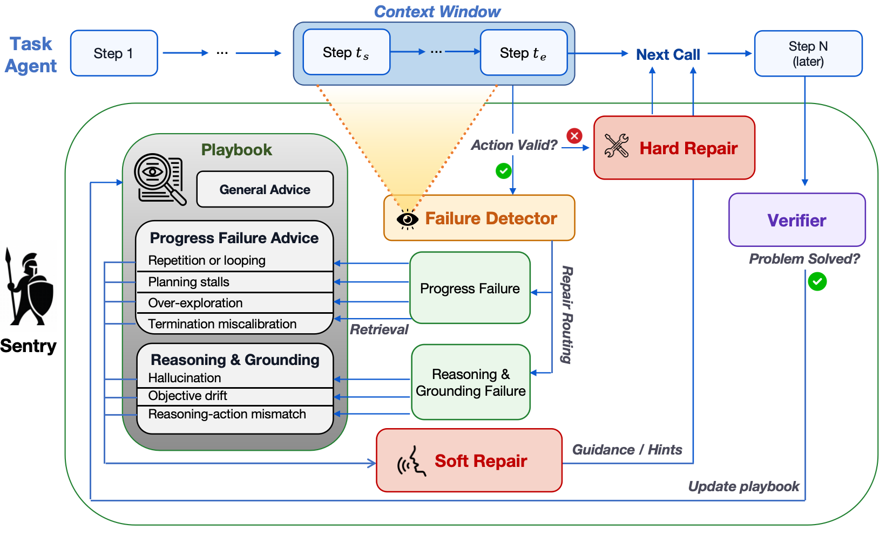

<h1 align="center"><strong>Sentry: An external self-improving failure management layer for LLM agents.</strong></h1>

Sentry runs alongside your agent loop to detect failures, guide recovery, and learn reusable lessons from verified recoveries.

**[Quick Start](#quick-start)**  |  **[Paper (arXiv)](https://arxiv.org/abs/2610.02994)**  |  **[License](LICENSE)**

  

## What is Sentry?

Sentry is an external runtime failure management layer for LLM agents. It helps agents fix invalid actions and recover when they get stuck in loops, drift from the task, or make unsupported assumptions. Unlike typical runtime monitors with fixed advice, Sentry learns and evolves from recoveries that work. By detecting failures, guiding recovery, and checking that the repair worked, Sentry helps agents become more reliable across tasks without cluttering their context.

## Demo


## Key Results

Results reported in the [paper](assets/Sentry_paper.pdf):

- **37% average relative improvement** over the strongest runtime-intervention baseline across WebShop, AppWorld, SWE-bench Lite, and Mind2Web Replay.
- **39% average relative improvement** over the strongest context-evolution baseline on held-out WebShop and Mind2Web Replay tasks.
- **1.54× base-agent token usage**, versus 2.44× for AgentForesight.
- **Lower average task latency** than the base agent on SWE-bench Lite (31.7s saved) and AppWorld (45.6s saved).
- **81.7% recovery rate** across 939 detected failures.

## Quick Start

### Installation

Sentry requires Python 3.10 or later.

```bash
git clone https://github.com/nuglifeleoji/Sentry.git
cd Sentry
python -m venv .venv
source .venv/bin/activate
python -m pip install -e .
```

### Configure a Model

Copy the OpenAI configuration template, then set your model ID:

```bash
mkdir -p outputs
cp configs/providers/openai.yaml outputs/sentry.yaml
export OPENAI_API_KEY="your-api-key"
```

In `outputs/sentry.yaml`, replace `YOUR_DEPLOYMENT_MODEL_ID` with the exact model ID available to your account. Then validate the configuration:

```bash
sentry-validate outputs/sentry.yaml
```

Validation prints the resolved configuration as JSON without making a model request. For other providers or a local endpoint, see [Model providers](docs/model-providers.md).

### Try a Recovery

Run this Python example from the repository root. It submits an intentionally malformed action and asks the configured model to rewrite it:

```python
from Sentry import SentryRunner, agent_step_from_parts

runner = SentryRunner.from_yaml("outputs/sentry.yaml")
runner.start_task(
    objective="Inspect item 42 to check its price.",
    action_schema='Return JSON: {"tool": "inspect", "args": {"item_id": <integer>}}',
)

try:
    step = agent_step_from_parts(
        step_id=0,
        reasoning="Open the item details before deciding whether to buy.",
        raw_action="inspect item 42",
        observation="Item 42 is visible; its price has not been inspected.",
        parsed_ok=False,
        schema_valid=False,
        parser_error="Expected a JSON object; received plain text.",
    )
    repair = runner.step(step)
    if repair is not None:
        print("Repair route:", repair.route)
        print("Next action:", runner.generate_repair(repair))
finally:
    runner.finalize()
```

The route is `hard_repair`; the next action is model-generated and should follow the JSON schema. This example makes one model request and does not execute the returned action.

For a real agent, submit each action-observation cycle to Sentry and include any returned guidance when generating the next action. Your application handles action generation, validation, execution, and task completion. Follow [Agent integration](docs/agent-integration.md) for the full lifecycle and validity rules.

## How It Works



1. **Failure Detection:** Sentry monitors recent agent steps for invalid actions and behavioral failures.
2. **Hard Repair:** Sentry asks the agent to retry invalid actions in the required format.
3. **Soft Repair:** Progress and reasoning failures receive targeted guidance from relevant playbook lessons.
4. **Recovery Verification:** Sentry checks whether the agent recovers over the following steps.
5. **Online Playbook Learning:** Verified soft recoveries become reusable lessons for similar failures across tasks.

## Documentation

| Guide | Contents |
| --- | --- |
| [Agent integration](docs/agent-integration.md) | Task lifecycle, step inputs, repair guidance, and recovery verification |
| [Model providers](docs/model-providers.md) | Credentials, provider templates, and endpoint configuration |
| [Playbook and logging](docs/playbook-and-logging.md) | Cross-task memory, persistence, explicit loading, and runtime logs |
| [AppWorld benchmark](docs/appworld-benchmark.md) | Environment setup, task selection, run limits, and result files |
| [Runtime defaults](docs/runtime-defaults.md) | Algorithm and decoding settings used by the implementation |

The [paper](assets/Sentry_paper.pdf) also examines conditional lesson exposure, fine-grained retrieval, transfer to unseen tasks, and combining Sentry with context evolution.

## Release Status

This checkout includes the Sentry runtime, model-provider adapters, configuration templates, tests, and an AppWorld reference benchmark. The benchmark runner currently supports AppWorld dev tasks. The other benchmarks reported in the paper do not yet have runners in this checkout.

## Citation

If you use Sentry in your research, please cite:

```bibtex
@article{ji2026sentry,
  title={Sentry: Learning to Recover from LLM Agent Failures at Test Time},
  author={Ji, Changxiu and Lu, Amy and Zhang, Qizheng and Olukotun, Kunle},
  journal={arXiv preprint arXiv:2610.02994},
  year={2026}
}
```

## License

Sentry is released under the [MIT License](LICENSE).
